  

  

  

> _From the war journal of **con-gif-stack**..._

- 🎓 Armed with a **business degree** and teaching myself to build with AI
- 🤖 Training under **Claude Code**, one commit at a time
- 💼 Fighting where **business meets tech**: automation, tools and side quests
- 🏋️ Fun fact: I can bench **300 lbs**

| Quest | What it is | Status |
| :-- | :-- | :-- |
| ⛷️ **Ski Game** | Building a ski game | 🔥 Raging (in progress) |
| 🤖 **Claude Code** | Learning to build with Claude Code | 🔥 Raging (in progress) |
| 🐙 **GitHub** | Learning Git & GitHub | 🔥 Raging (in progress) |

- 🤖 Claude Code and AI-assisted development
- 🐙 Git & GitHub
- 📜 Markdown
- 🧠 Prompting and AI workflows

  
  
  
  
  
  
  

  
  

  

  

Pixel art is original and generated by <code>assets/gen.py</code>. Run <code>python3 assets/gen.py</code> to regenerate.
